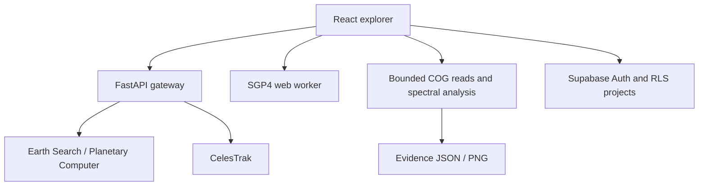

# TerraSeek World · 0.2.0

An open-source Earth observation workspace for exploring real satellite scenes and measuring bounded, traceable spectral changes.

**[Live explorer](https://terraseek-world.vercel.app) · [API documentation](https://terraseek-world.vercel.app/api/v1/docs)**

This is an **exploratory release, not a production-certified geospatial SaaS**. No generated scenes, invented confidence scores or simulated analytical results are used in the live workflow.

## Current capability and verification

| Capability | Implementation | Verification |
|---|---|---|
| Place / coordinate search | Photon gateway and coordinate validation | Live API verified |
| 3D globe | React Three Fiber, Earth texture, fly-to, orbital points | Compiles; GPU visual QA still needed |
| 2D fallback | Leaflet raster map and bounded AOI rectangle | Replaces WebGL-dependent fallback |
| Orbital catalog | CelesTrak active group; SGP4 worker; replay and sampled passes | Live catalog verified; pass timing not independently validated |
| Sentinel-2 discovery | Earth Search STAC, dates and cloud filter | Live Pune query verified |
| Landsat / Sentinel-1 | Planetary Computer discovery | Discovery only; no quantitative sensor analysis |
| Comparison | Same-tile crops, common 20 m UTM grid, swipe / side-by-side | Live pair and export verified in prior browser session |
| Quality / change | Joint SCL 4/5/6 mask, calibrated reflectance, NDVI difference, NDWI water threshold | Unit tests and real-data numerical regression |
| Evidence export | JSON provenance, areas, method, limits; crop PNG | Browser JSON download verified |
| Natural-language input | Deterministic location/year/intent patterns | Tested; not semantic retrieval |
| Accounts | Supabase Auth client, project saves, RLS migration | Pending accessible Supabase project and end-to-end auth tests |
| Sector selection | Report context only | No industry-specific classifier implied |

### What is not implemented

Arbitrary AOI polygons, large-area durable processing jobs, validated land-use/construction/mining classification, image-to-image embeddings, LLM assistance, shared teams, billing, recurring monitoring, full offline data packaging, defence certification and production SLOs. A 2.56 km crop is not an all-scale monitoring service. No daily global or submeter coverage is promised.

## Run locally

```sh
npm ci
python -m pip install -r requirements.txt uvicorn
python -m uvicorn services.api.app.main:app --port 8000
# In another terminal
npm run dev
```

Copy `.env.example` values into your deployment configuration when available. Never commit credentials. The public explorer needs no account key. Supabase cloud saves require a project, schema, auth redirect configuration, and public client key. Do not use service-role keys in frontend variables.

## Test and build

```sh
npm test
npm run build
python -m pip install pytest rasterio numpy pyproj ruff
python -m pytest services/api/tests -q
python -m ruff check services --select E9,F63,F7,F82
npm audit --omit=dev --audit-level=high
python scripts/check_secrets.py
# Optional browser suite; install Playwright Chromium in your test environment first
BASE_URL=https://terraseek-world.vercel.app npx playwright test
```

The recorded real Sentinel fixture checks numerical reproducibility, **not accuracy against field ground truth**. Network tests should not fabricate successful responses when a provider is unavailable.

## Architecture



`apps/web` contains the frontend; `services/api/app/main.py` is the bounded metadata API. `services/api/app/analysis.py` is a separate Rasterio engine for dedicated/offline execution and is not imported by Vercel functions. `supabase/migrations` contains the prepared owner-scoped data model. See [architecture decisions](docs/architecture/decisions.md), [research audit](docs/research/audit.md), [security boundaries](docs/security/threat-model.md), [deployment setup](docs/deployment/setup.md), and [commercial hypotheses](docs/business/commercialization.md).

## Scientific limits

Both scenes must cover the crop and share a tile/projection. Scale/offset metadata and the provider's applied-offset flag are respected. Nearest-neighbor sampling gives a common 20 m grid; it does not correct residual subpixel registration. SCL masking is imperfect and does not restore haze. NDVI decrease is not proof of vegetation clearing; water thresholds are exploratory. Seasonal/illumination/moisture differences can dominate results. Reports identify source acquisitions and processing assumptions.

## Ownership and licensing

Maintainer: Nirbhay Alone, `nirbhayalone27`. AI-assisted implementation with Codex. Original code is MIT; upstream imagery, map and texture licenses remain applicable. See [third-party notices](THIRD_PARTY_NOTICES.md). Watched.earth was an architectural reference; TerraSeek is independently branded.
